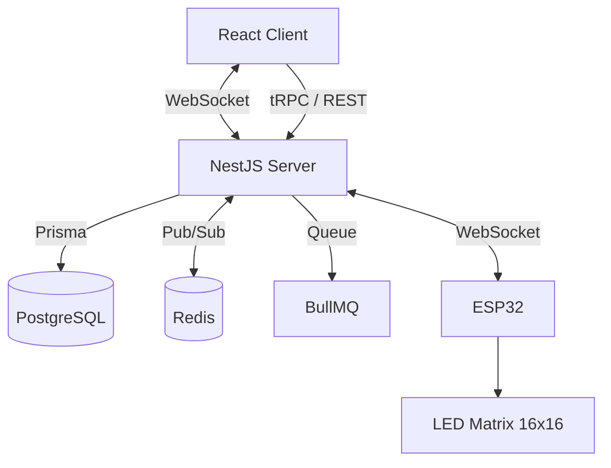

<h2>Веб-приложение для рисования на матрице 16×16 через ESP32.</h2>

- Главная страница


## Стек

| Client | Server | Infra | Test |
|--------|--------|-------|------|
| React<br>TypeScript<br>Vite<br>Zustand<br>Socket.IO Client<br>tRPC Client | NestJS<br>TypeScript<br>tRPC<br>BullMQ<br>Prisma<br>PostgreSQL<br>Redis<br>Socket.IO | Docker Compose<br>PostgreSQL<br>Redis | Unit<br>Integration |

## Структура
```
- client/ — React + Vite
- server/ — NestJS
- docker-compose.yml
- firmware/
```

## Требования
```
- Node.js 20+
- Docker Desktop
- npm
```

## Запуск

- Из корня проекта:

```bash
npm run start
```

## Архитектура



## Что дальше

```
- Прошивка ESP32: подключение к WebSocket, отрисовка через FastLED
- BullMQ: очередь кадров для плавной смены пресетов
- Redis: хранение текущего состояния доски
- Покрытие тестами: unit, integration
- Добавить картинки в README файл
```